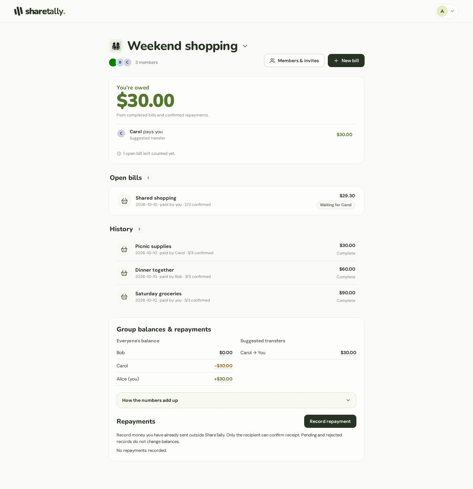
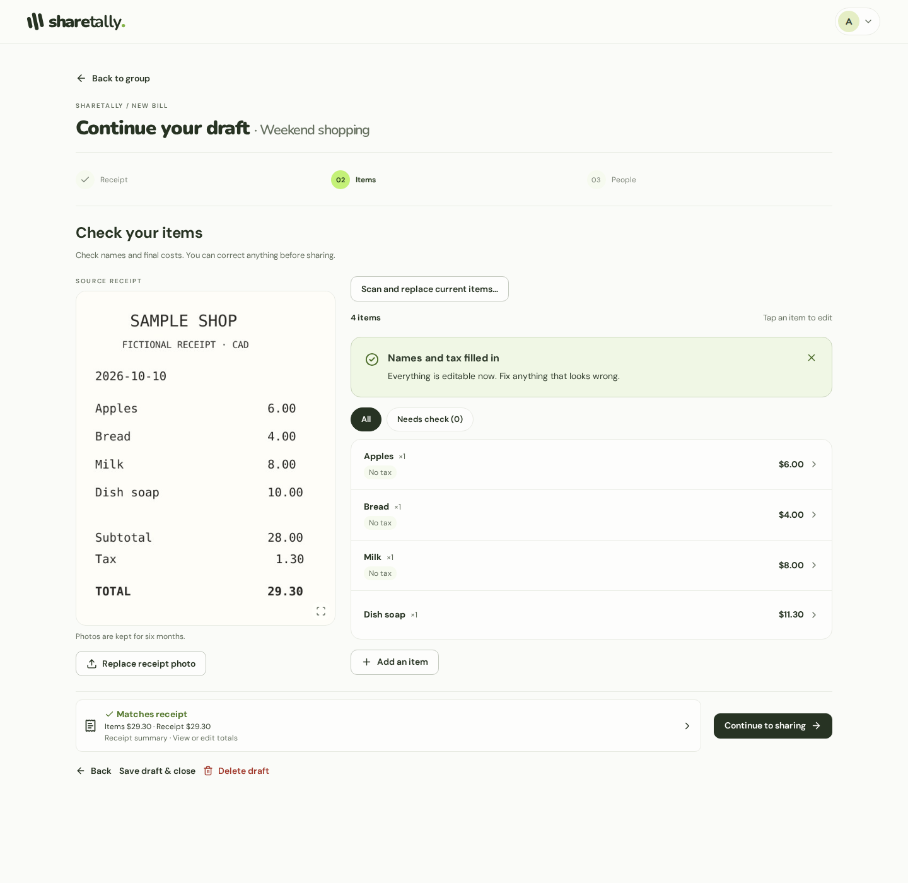
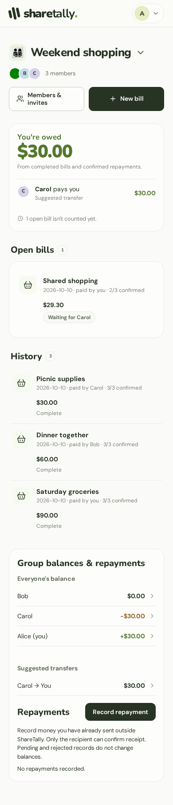

# ShareTally

Split shared purchases with friends and work out who owes whom. Built for Costco runs, shared meals, and everyday group shopping.

**Try it: [sharetally.app](https://sharetally.app)**

## Demo

https://github.com/user-attachments/assets/015d0bca-19ba-416f-a414-3a761ddbe565

A 60-second tour with fictional people and a made-up receipt: scanning a receipt, claiming items, live updates, and confirming a repayment.

## Features

- Create groups and invite friends with a link.
- Split a bill by amount: each participant enters their own share or chooses a portion of the total, then confirms it.
- Scan a receipt, crop its photo, and review item names, prices, tax and discounts before sharing the bill. You can also enter items manually.
- Split by item: claim whole items or exact fractions, check what others have claimed, and confirm your own share.
- Save private bill drafts and resume them later. Attach up to three note photos to show the purchases or how they were divided.
- Find bills and repayments that need your attention. Shared bills and balances update live.
- See each group's net balances and repayment suggestions using the fewest transfers, with explanations of how the amounts add up.
- Record repayments made outside the app. The recipient confirms receipt or rejects an incorrect record.
- Leave a group once your balance is zero and your unfinished activity is resolved. Group owners can remove eligible members, pass on ownership when leaving, or delete a cleared group.
- Choose group icons and appearance palettes, with light, dark and match-device modes.

ShareTally does not move money. It currently supports CAD and groups of up to 16 people. Completed bills are final. Repayments affect balances only after the recipient confirms them.

## Screenshots

Captured from the local app on 2026-10-13 using fictional data for Alice, Bob, and Carol, including a synthetic receipt.

### Group bills and balances

### Receipt review

### Mobile

## Tech stack

- Frontend: React, TypeScript, Vite, and TanStack Query.
- Backend: Node.js, Express, PostgreSQL, and Drizzle ORM.
- Authentication: Clerk with Google sign-in.
- Receipts: Azure Document Intelligence for extraction and an OpenAI-compatible API for clearer item names.
- Deployment: Railway (API/web), Neon (PostgreSQL), Nginx, and Drone CI; Docker Compose for local runs.

## Project docs

- [Architecture and code structure](docs/architecture.md)
- [Local development and tests](docs/development.md)
- [Deployment and operations](docs/operations.md)
- [Project background and development guidelines](docs/project-brief.md)
- [Domain terminology](GLOSSARY.md)
- [Architecture and business decisions](docs/adr/)
- [Product requirements](https://github.com/SimianW/share-tally/issues/1)
- [Receipt extraction and item claiming requirements](https://github.com/SimianW/share-tally/issues/26)
