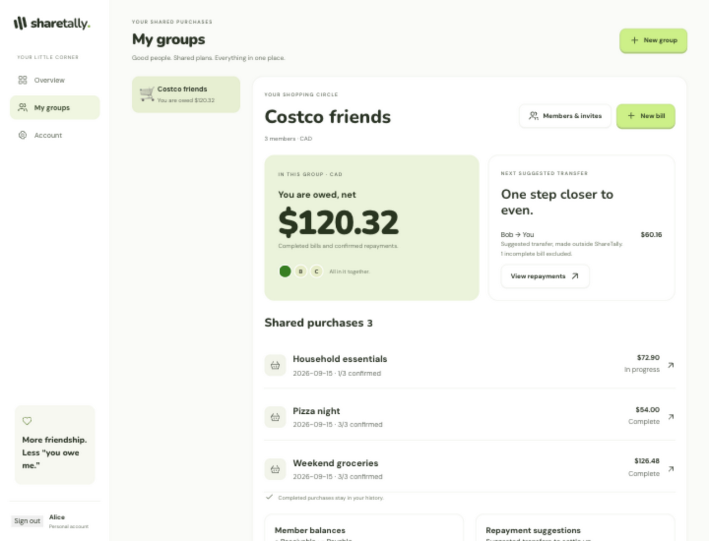
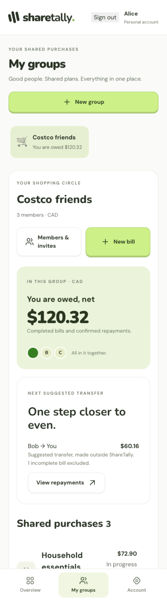

# ShareTally

Split shared purchases with friends and work out who owes whom. Built for Costco runs, shared meals, and everyday group shopping.

**Try it: [sharetally.app](https://sharetally.app)**

## How it works

1. Sign in, create a group, and invite friends with a link.
2. Add a bill. Enter amounts manually, or upload a receipt and review the extracted items before publishing.
3. Each person enters and confirms their own share, or claims whole items or fractions of an item.
4. Once a bill is complete, check the group's balances and repayment suggestions.
5. Transfer money outside the app, then record the repayment. The recipient confirms receipt to update the balances.

ShareTally does not move money. It currently supports CAD and groups of up to 16 people. Completed bills are final. Repayments affect balances only after the recipient confirms them.

## Screenshots

Captured from the local app using sample data for Alice, Bob, and Carol.

### Group bills and balances

### Mobile

## Tech stack

- Frontend: React, TypeScript, Vite, and TanStack Query.
- Backend: Node.js, Express, PostgreSQL, and Drizzle ORM.
- Authentication: Clerk with Google sign-in.
- Receipts: Azure Document Intelligence for extraction and an OpenAI-compatible API for clearer item names.
- Deployment: Railway (API/web), Neon (PostgreSQL), Nginx, and Drone CI; Docker Compose for local runs.

## Project docs

- [Architecture and code structure](docs/architecture.md)
- [Local development and tests](docs/development.md)
- [Deployment and operations](docs/operations.md)
- [Project background and development guidelines](docs/project-brief.md)
- [Domain terminology](GLOSSARY.md)
- [Architecture and business decisions](docs/adr/)
- [Product requirements](https://github.com/SimianW/share-tally/issues/1)
- [Receipt extraction and item claiming requirements](https://github.com/SimianW/share-tally/issues/26)
